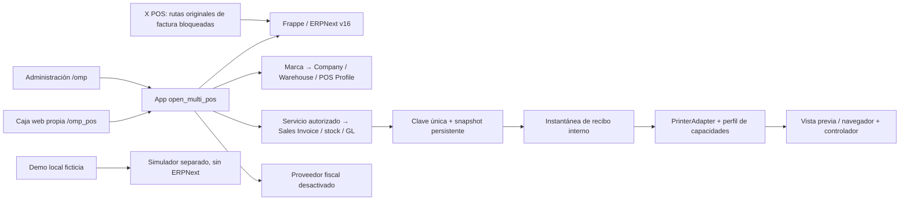

# Arquitectura

ERPNext conserva catálogo, precios, impuestos, documentos, stock y contabilidad. La extensión añade marca, terminales, un servicio autorizado de caja y journals privados de idempotencia/snapshot. No copia ni modifica core. El backend en línea usa Sales Invoice con stock/GL inmediatos y aperturas/cierres nativos. La pantalla autenticada `/omp_pos` usa el contrato de [native-checkout.md](native-checkout.md); no usa el ledger de demo ni creación de factura X POS. [Uso y recuperación](cashier-ui.md).

Desarrollo local validado: backend y herramientas en Ubuntu WSL; navegador, controlador de impresión y lector en Windows. Chrome Windows alcanza el servicio web WSL en loopback y ejecutó el recorrido de venta/recuperación/cierre con dos cajeros. La conexión de varios computadores requiere un servidor accesible con autenticación/TLS; no se habilita exponiendo el sitio de ensayo. Ver [local-services.md](local-services.md).

Una marca no es una entidad legal. Su configuración referencia Company, Warehouse y POS Profile; se valida que pertenezcan a la misma Company y que el almacén coincida con el perfil. Acceso por lista explícita de usuarios más permisos nativos. La selección del cliente nunca concede acceso.

Demo: servidor loopback y SQLite con datos ficticios, dos usuarios de simulación elegibles y tres perfiles de impresora. La selección de usuario es un control de demostración, no un login. Ningún impuesto/ledger simulado debe reutilizarse como motor productivo.

Impresión: el recibo es una instantánea de marca y líneas al completar la venta. Cambiar impresora solo cambia el layout; no recrea la venta. El navegador no certifica que salió papel. Estado del trabajo: vista previa, diálogo solicitado o error; no marcar impreso sin confirmación física.

Ver [ADR-001](decisions/ADR-001-base.md), [upstream.md](upstream.md) y [offline-sync.md](offline-sync.md).

El navegador persiste solo el payload del intento (terminal, UUID, quote y medios/importes) por sitio/usuario, antes del POST. Web Locks serializa pestañas del mismo origen/perfil; otro navegador/equipo no comparte ese bloqueo. No persiste catálogo, cliente ni snapshot. El tombstone servidor de `abandon_checkout` comparte el mutex del checkout y bloquea claves/cotizaciones liberadas, incluso ante una solicitud tardía. No concilia pagos externos ni implementa offline.

## Espacio administrativo y cesta conjunta

`workspace.py` exige sesión administrativa antes de leer o escribir. Crea documentos nativos para negocio, catálogo, precio, existencias y usuarios; no usa `ignore_permissions`. La relación negocio/Company se elige al crear el negocio. Los administradores tienen roles nativos de gestión; un cajero no recibe esos roles ni acceso al espacio administrativo.

`batch.py` autoriza las terminales, toma bloqueos de perfil en orden común y agrupa hasta dos servicios de checkout en la misma transacción de Frappe. Si falla un hijo, se revierten las dos facturas y sus efectos. El journal privado usa clave usuario/UUID y hash del payload. Estado, reintento y resolución no generan otra clave. Una marca de abandono bloquea solicitudes tardías. La instantánea conjunta conserva los snapshots nativos por negocio y sus opciones de contacto; la vista previa no vuelve a cotizar ni cobrar.

Las entradas de inventario usan una clave única en Stock Entry, hash de payload y una marca privada para bloquear intentos abandonados. Web Locks coordina pestañas del mismo navegador. Un bloqueo o interbloqueo nativo puede responder 409: el cliente conserva el intento y lo recupera con la misma clave.

Una extensión de clase Frappe permite una apertura por usuario/perfil para administradores de negocios visibles en `/omp`. No modifica core; mantiene validaciones nativas de empresa, cuentas y estado. Los cajeros y perfiles ajenos al espacio conservan la regla original. El cierre nativo filtra facturas por propietario y perfil.

Compras, finanzas, clientes y entidad legal se muestran en formularios/informes nativos dentro del espacio, con idioma y filtro de empresa. El filtro es contexto de trabajo, no un permiso. Los administradores conservan acceso administrativo al sitio; los permisos de cajero se verifican en servidor.

## Devoluciones guiadas

`returns.py` exige administración, terminal personal y acceso actual al negocio y a la factura original del journal de caja. Usa el mapper nativo de nota crédito y conserva precios/impuestos originales; no copia el motor contable. Bloquea perfil, factura original e intento, consulta devoluciones enviadas con lectura actual y valida cantidades e importe acumulado. La huella de cálculo detecta cambios antes de registrar. Cada nota conserva su empresa, perfil, almacén y factura original; las dos facturas de una cesta se devuelven por separado.

El journal privado `OMP Return Request`, identificado por usuario/UUID, guarda payload, estado, nota y comprobante en la misma transacción que stock, GL y pagos negativos nativos. Un abandono bloquea envíos tardíos; recuperación/reintento no crea otra nota. La revisión de apertura avanza al reembolsar para que el cierre no use una vista anterior. La copia/restauración incluye este journal como tabla número 19.

El navegador conserva el payload del intento antes de enviar, por sitio/usuario, y coordina pestañas con Web Locks. No conserva el comprobante en almacenamiento local. La interfaz no ejecuta transferencias ni confirma entrega de efectivo. Series/lotes, ajustes globales, fracciones y diferencias de redondeo requieren el formulario nativo; el servicio falla antes de registrar si no puede conciliar cantidades/importes.

## Importación guiada de catálogo y existencias

`imports.py` autoriza al administrador y su negocio en cada llamada POST. `import_contract.py` valida CSV UTF-8 con límites de filas/tamaño, campos tipados y rechazo de fórmulas. La preparación conserva filas normalizadas y plan en `OMP Import Request`, privado; no escribe catálogo ni ledger. El navegador persiste solo negocio, usuario/origen, UUID, fase, hash y confirmación de repetición, sin CSV ni catálogo.

Perfil, negocio, intento, productos, precios y existencias se leen bajo bloqueos. El hash del plan incluye sus revisiones; aplicar vuelve a calcularlo y exige revisar cualquier cambio. Los índices de negocio/nombre y negocio/contenido/estado se crean durante instalación/migración. Se bloquean SKU y códigos repetidos, productos ajenos y configuraciones nativas no soportadas. Las lecturas de precios y movimientos previos usan consultas actuales después de esperar bloqueos.

Crear usa el servicio existente de SKU; actualizar conserva el código y agrega códigos de barras sin sustituirlos. Las cantidades son entradas adicionales, consolidadas en una Stock Entry de Material Receipt. Item, Item Price, Stock Entry enviada, SLE, GL y resultado del journal comparten transacción y permisos nativos. Un fallo revierte todo. No se modifica core ni se usa ignore_permissions. Los reintentos de un UUID devuelven el resultado original; abandonar deja una marca que bloquea solicitudes tardías. Repetir contenido con otra clave requiere confirmación explícita; no identifica entregas físicas por sí solo.

La recuperación vuelve a autorizar productos y documento nativo. Un movimiento anulado no se recrea por reintento. El respaldo completo incluye filas normalizadas y resultados privados; la conciliación añade Item Barcode y OMP Import Request, para 21 tablas.
