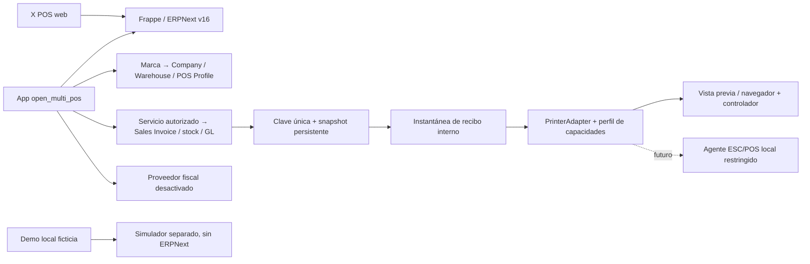

# Arquitectura

ERPNext conserva catálogo, precios, impuestos, documentos, stock y contabilidad. La extensión añade marca, terminales, un servicio autorizado de caja y journals privados de idempotencia/snapshot. No copia ni modifica core. El backend en línea usa Sales Invoice con stock/GL inmediatos y aperturas/cierres nativos. La pantalla de caja todavía debe conectarse al contrato de [native-checkout.md](native-checkout.md).

Desarrollo local validado: backend y herramientas en Ubuntu WSL; navegador, controlador de impresión y lector en Windows. Chrome Windows alcanza el servicio web WSL en loopback. La conexión de varios computadores requiere un servidor accesible con autenticación/TLS; no se habilita exponiendo el sitio de ensayo. Ver [local-services.md](local-services.md).

Una marca no es una entidad legal. Su configuración referencia Company, Warehouse y POS Profile; se valida que pertenezcan a la misma Company y que el almacén coincida con el perfil. Acceso por lista explícita de usuarios más permisos nativos. La selección del cliente nunca concede acceso.

Demo: servidor loopback y SQLite con datos ficticios, dos usuarios de simulación elegibles y tres perfiles de impresora. La selección de usuario es un control de demostración, no un login. Ningún impuesto/ledger simulado debe reutilizarse como motor productivo.

Impresión: el recibo es una instantánea de marca y líneas al completar la venta. Cambiar impresora solo cambia el layout; no recrea la venta. El navegador no certifica que salió papel. Estado del trabajo: vista previa, diálogo solicitado o error; no marcar impreso sin confirmación física.

Ver [ADR-001](decisions/ADR-001-base.md), [upstream.md](upstream.md) y [offline-sync.md](offline-sync.md).
