# Manual de administración

Este manual acompaña el menú de `/omp`. Usa cuentas personales y verifica el negocio activo antes de cada operación. La configuración inicial y los límites técnicos están en [Espacio administrativo](workspace.md).

Las capturas contienen datos inventados. Los nombres, NIT, contactos, correos, cuentas y productos reales se completan solo en la instalación privada. Los formularios de compra, finanzas y clientes son los documentos nativos de ERPNext. Guardar conserva un borrador; Enviar produce los efectos propios del documento.

Atajos: **Ctrl K** busca una sección; **Tab** recorre controles; **Enter** activa un botón o confirma el código del lector; **Escape** cierra ayudas y tutoriales. Cada formulario incluye ayuda con `?`. Las guías son opcionales y se pueden repetir desde Guía de esta sección o Ayuda.

Los botones del menú y las acciones principales muestran una explicación al pasar el puntero o recibir foco con Tab. Escape la cierra. En una pantalla táctil, consulta la descripción de la sección, los botones `?` y su guía.

Para usar los mismos datos desde otros computadores, consulta [acceso privado y datos compartidos](online-access.md). Todos usan el mismo servidor Windows con cuentas personales. La conexión debe estar disponible para guardar operaciones.

## Inicio

Revisa el negocio activo y entra a la tarea que necesitas.

1. **Crea tu acceso.** En la primera instalación, entra con la cuenta de instalación y usa Crear mi perfil de administrador. Escribe tu correo y una contraseña. Después, inicia sesión con tu cuenta personal. Solo un administrador puede crear otros perfiles.
2. **Configura los negocios.** En Negocios, crea cada negocio. Puedes elegir la misma entidad legal si comparten NIT y contabilidad, o crear entidades distintas. Esta decisión se configura durante el alta.
3. **Selecciona el contexto.** El selector cambia el inventario, las compras, las finanzas y los ajustes que estás consultando. En ventas, cada producto conserva su negocio aunque cambies el selector.
4. **Consulta la operación.** Ventas de hoy cuenta las ventas enviadas del perfil activo y excluye notas crédito. Importe neto de hoy suma las ventas y resta las devoluciones enviadas en esa fecha. Ventas recientes distingue ventas y notas crédito, con documentos, fechas y clientes. No representa utilidad ni saldo bancario.
5. **Encuentra herramientas.** Usa el menú izquierdo o presiona Ctrl K y escribe el nombre de una sección. Mi perfil abre tu cuenta para actualizar datos o contraseña.

- El sitio requiere conexión con el servidor. Una respuesta perdida se resuelve consultando el mismo intento.
- Todos los datos de las capturas del manual son ficticios.

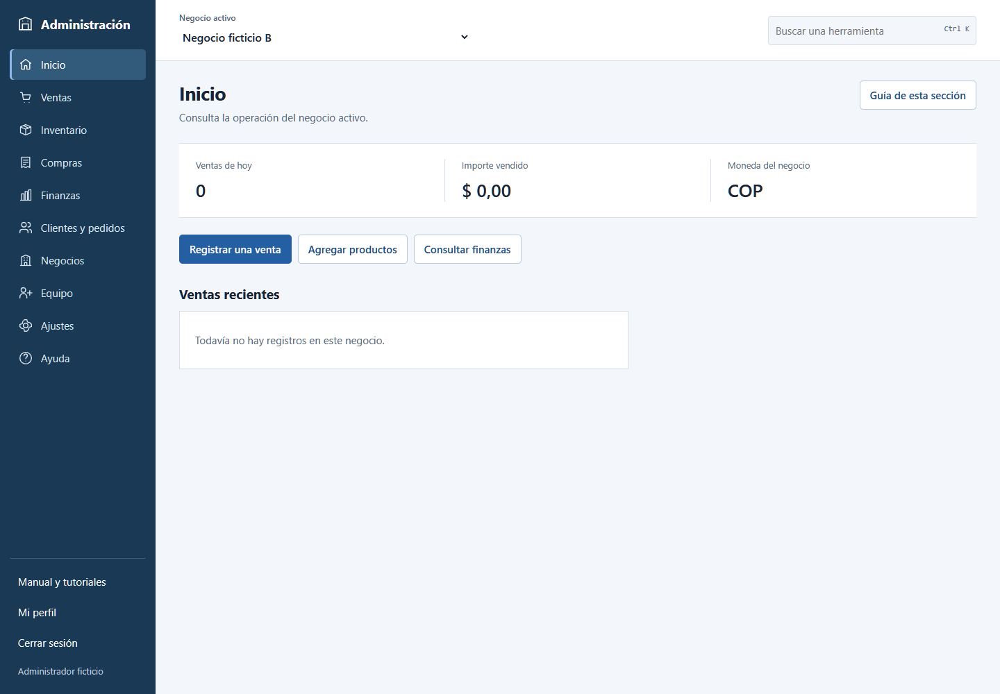

## Ventas

Vende productos de uno o ambos negocios y conserva una factura nativa por negocio.

1. **Abre las cajas.** Usa Abrir caja para cada negocio que participará. Registra el saldo inicial de efectivo y transferencia; cero es válido. No se puede vender con la caja cerrada.
2. **Escanea o busca.** Deja el cursor en Escanea o busca un producto. El lector busca códigos en los negocios habilitados. Una coincidencia exacta se agrega; si hay varias, selecciona la correspondiente. También puedes escribir un nombre y usar Buscar.
3. **Comprueba cada línea.** La cesta muestra nombre, código, cantidad y negocio propietario. Cambia la cantidad o retira una línea antes de calcular. El código interno debe distinguir productos independientes, incluso si comparten código de barras.
4. **Calcula y registra los pagos.** Calcular total consulta precios, impuestos y existencias nativos. Registra el dinero recibido en cada negocio y medio. El efectivo puede generar cambio. Una transferencia requiere tu confirmación en el banco; el programa no la verifica.
5. **Guarda una sola vez.** Guardar venta conserva una clave antes de enviar. Si se pierde la respuesta, usa Consultar estado o Reintentar el mismo intento. Resolver sin crear venta recupera lo guardado o bloquea el intento para impedir que una solicitud tardía venda. No devuelve pagos externos.
6. **Imprime y cierra.** Imprimir recibo usa la venta guardada, sin volver a cobrar. Nueva venta limpia la cesta solo después de un resultado definitivo. Al terminar, Resumen y cierre permite contar cada medio y conservar diferencias.

- Una cesta conjunta exige la misma moneda. Los documentos, el inventario y las cuentas permanecen en la empresa de cada negocio.
- El recibo es interno y no tiene validez fiscal. DIAN no está configurada.
- Conserva la pestaña y sus datos locales mientras haya un intento pendiente. No borres el almacenamiento para repetir una operación.

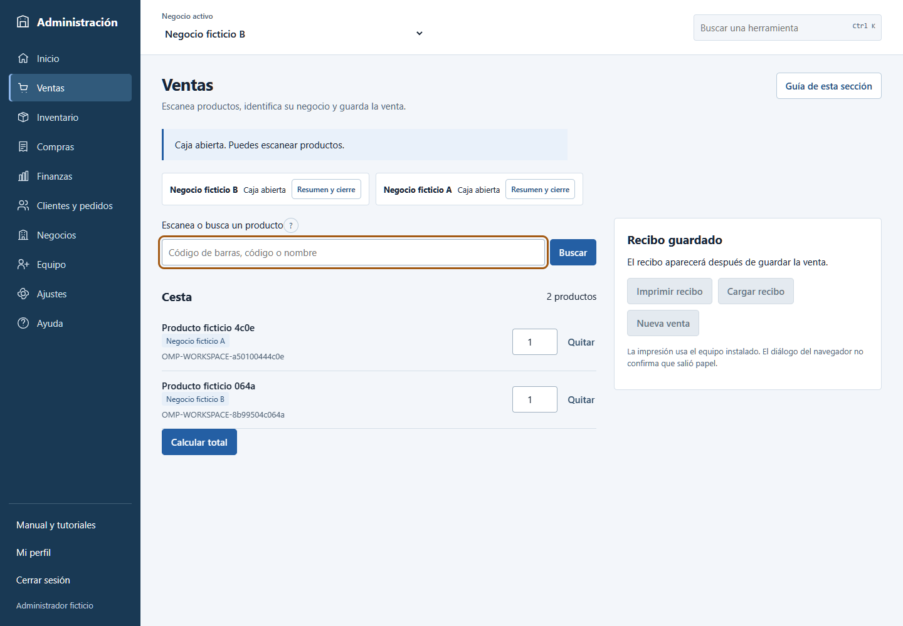

## Devoluciones

Registra devoluciones parciales o totales de ventas de caja de OpenMultiPOS. El proceso crea una nota crédito nativa vinculada a la factura original, devuelve las unidades al almacén original y registra importes negativos en los medios de pago de la caja actual. El programa no envía dinero al banco ni transmite documentos fiscales.

1. **Abre tu caja de hoy.** En Ventas, abre una caja personal del negocio que recibirá los productos. Puedes devolver una venta de una apertura anterior o de otro administrador autorizado; el reembolso se contabiliza en tu caja actual.
2. **Selecciona la venta.** En Devoluciones, confirma el negocio activo. Elige una factura reciente o escribe su número completo. Pulsa Cargar factura. La lista reciente consulta las últimas 30 facturas del negocio. Para revisar el documento completo, usa Abrir factura original en ERPNext.
3. **Elige las cantidades.** Cada producto muestra vendido, pendiente y precio original en su ayuda. Escribe una cantidad entera hasta lo pendiente; cero conserva el producto. Para una devolución total, selecciona todas las unidades pendientes. Calcular reembolso consulta precios e impuestos de la factura original, aunque el catálogo o el perfil hayan cambiado.
4. **Distribuye el reembolso.** Registra importes positivos en efectivo y transferencia. Deben sumar exactamente el total; usa cero en los medios que no corresponden. Añade una referencia para identificar la transferencia realizada fuera del programa. Explica el motivo y marca la confirmación después de revisar productos, cantidades e importes.
5. **Registra una sola vez.** Registrar devolución envía la nota crédito y sus movimientos nativos en la misma transacción. Si falla la validación, no se conserva una nota parcial ni movimientos de stock/contabilidad de ese intento. La operación utiliza una clave persistente; un reintento no crea otra nota.
6. **Conserva el comprobante.** Ver nota crédito en ERPNext abre el documento. Imprimir comprobante usa la instantánea guardada, con los datos del negocio de la venta original y la referencia de esa factura. Nueva devolución libera la pantalla después de confirmar el resultado. Revisa en el cierre que los reembolsos resten del medio correcto. Si el esperado es negativo, registra el saldo real contado y revisa la diferencia; no inventes un conteo negativo.

**Si se pierde la respuesta**, conserva la sesión y los datos locales. Consultar estado recupera la misma nota. Reintentar devolución usa la misma clave. Resolver sin crear otra nota recupera lo ya guardado o bloquea la clave para que un envío tardío no cree una devolución. Resolver no entrega ni recupera dinero externo; comprueba cualquier reembolso realizado antes de iniciar otro intento.

**Un recibo conjunto tiene dos facturas.** Devuelve cada factura desde su negocio. Puedes devolver solo una parte de un negocio sin afectar al otro. Si devuelves productos de ambos, registra una operación para cada factura; sus notas, reembolsos y existencias permanecen separados.

Las series/lotes, cantidades fraccionarias, descuentos globales, cargos fijos, notas previas sin vínculo de línea y diferencias de redondeo requieren revisar la devolución en el formulario nativo. Usa Abrir factura original en ERPNext y su acción nativa de devolución; revisa importes, existencias y pagos antes de enviar. Revisar notas crédito en ERPNext permite consultar las notas existentes. Una factura o nota anulada requiere revisión nativa y no se recupera como una devolución vigente.

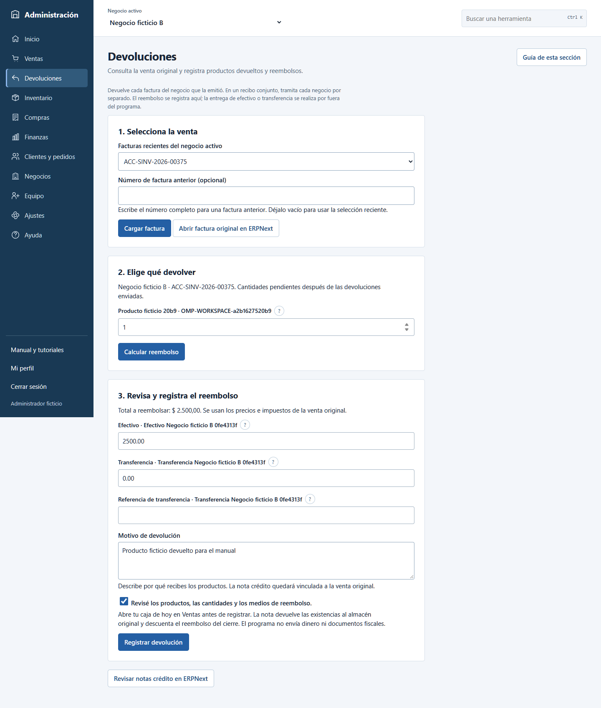

## Inventario

Crea productos con propietario y registra unidades en el almacén correcto.

1. **Confirma el negocio.** Verifica el selector y el almacén mostrado. Los productos nuevos quedan vinculados a este negocio.
2. **Crea el producto.** Nuevo producto pide nombre, código de barras, precio y grupo. El SKU se genera con el prefijo del negocio, el nombre sin tildes y un consecutivo asignado por el servidor. No necesitas escribir un código. El producto comienza sin existencias.
3. **Registra unidades.** Ingresar existencias crea y envía una Entrada de inventario nativa. Elige producto, unidades enteras y costo por unidad. El costo valora las existencias; no cambia su precio de venta.
4. **Recupera una entrada.** Si la conexión se interrumpe, Revisar entrada pendiente usa la misma clave. Resolver sin registrar otra entrada recupera el documento si existe o bloquea una solicitud tardía. No crea dos entradas por un reintento.
5. **Consulta existencias.** Busca por nombre y revisa código, código de barras, disponible y precio. Para mercancía con factura de proveedor, usa Compras para conservar el vínculo contable.

- Esta entrada directa no admite lotes ni números de serie; esos casos se gestionan con formularios nativos.
- No registres la misma recepción mediante entrada directa y factura/recepción de compra con actualización de existencias.

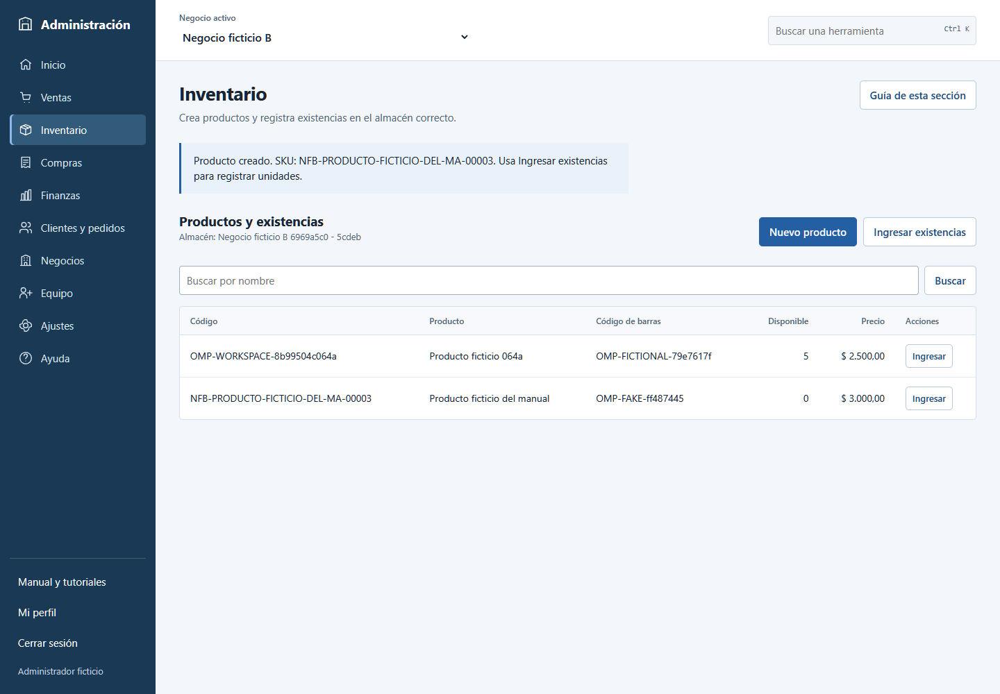

El SKU distingue productos independientes de cada negocio. Por ejemplo, un prefijo ficticio `TD` y el nombre `Café ámbar` producen `TD-CAFE-AMBAR-00001`. Puedes editar el prefijo en Negocios; los códigos existentes conservan su valor. El código de barras del empaque se registra por separado. Si se pierde la respuesta del alta, usa Revisar producto pendiente para recuperar el mismo producto.

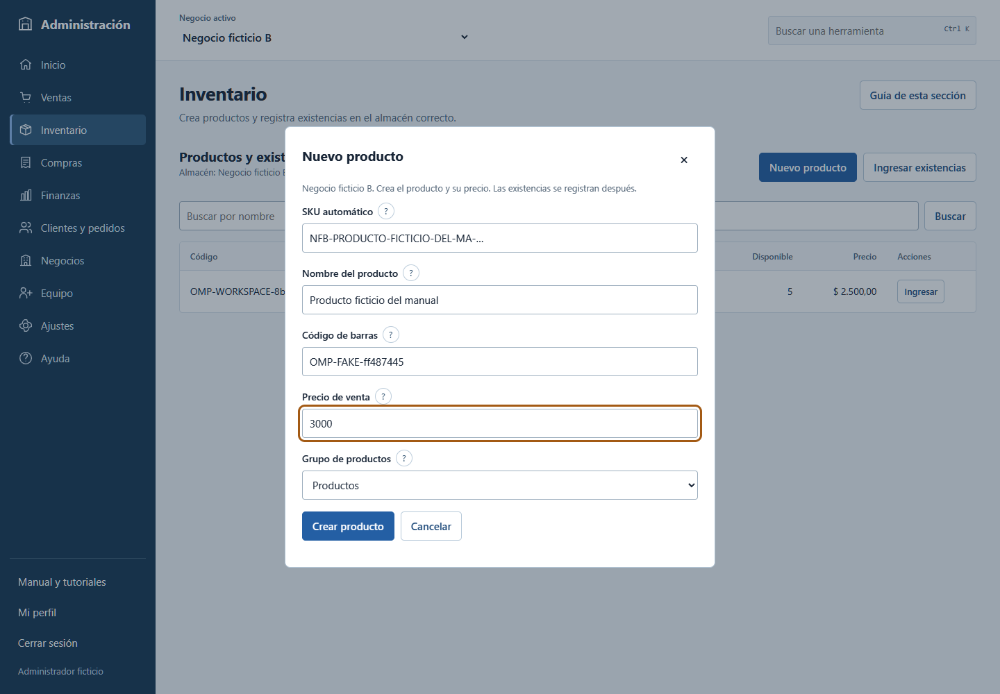

## Compras

Registra proveedores y compras con documentos de ERPNext.

1. **Selecciona la empresa.** El selector aplica el contexto de la entidad legal del negocio activo. Revisa Empresa y Almacén dentro de cada documento antes de enviarlo.
2. **Crea el proveedor.** Proveedores abre la lista nativa. Usa Nuevo, completa nombre y tipo, y guarda. Los datos permanecen en este sitio.
3. **Registra la compra.** Facturas de compra registra factura, proveedor, fechas, productos, costos e impuestos. Guardar conserva un borrador; Enviar registra los efectos contables. Activa actualizar existencias solo si corresponde a esa recepción.
4. **Usa pedidos y recepciones.** Órdenes de compra conserva lo solicitado. Recepción de mercancía registra lo recibido y permite crear la factura relacionada. Usa Crear en el documento nativo para conservar los vínculos.
5. **Revisa antes de enviar.** Comprueba totales, moneda, impuestos, empresa, almacén y documentos vinculados. Un documento enviado requiere el procedimiento nativo de cancelación y corrección.

- Los campos y acciones de estos formularios conservan la ayuda y los permisos de ERPNext.
- El menú muestra la entidad activa, pero cada documento conserva su empresa; cambiar el selector no traslada documentos.

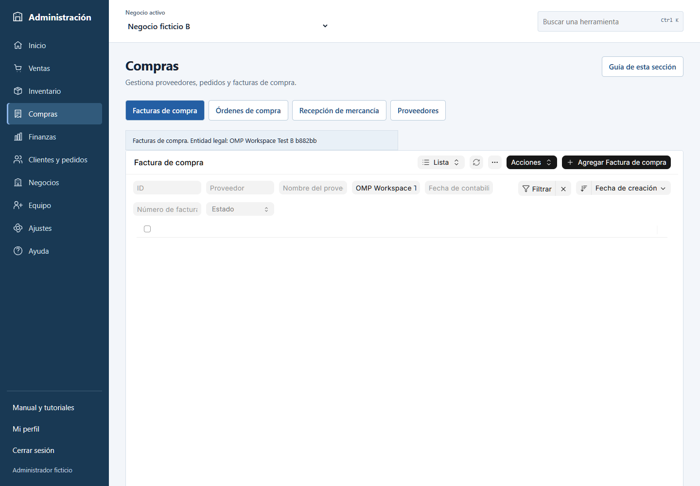

## Finanzas

Consulta cuentas y registra movimientos en la entidad seleccionada.

1. **Comprueba la entidad.** Revisa el negocio activo y el nombre de la entidad que aparece sobre el formulario. Dos negocios con la misma entidad comparten su contabilidad; las ventas siguen identificadas por perfil.
2. **Registra cobros y pagos.** Cobros y pagos abre Comprobante de pago. Elige Recibir o Pagar, tercero, cuenta, importe y facturas a conciliar. Guarda y envía cuando los datos coincidan con el movimiento real.
3. **Registra gastos.** Gastos y facturas abre Factura de compra. Para un gasto sin inventario, usa el producto/servicio y la cuenta de gasto correspondientes. No lo registres de nuevo si ya existe la factura.
4. **Consulta saldos.** Libro mayor muestra movimientos por cuenta y fechas. Cuentas por cobrar y Cuentas por pagar muestran obligaciones y vencimientos. Resultados compara ingresos y gastos. Ajusta los filtros del informe y actualiza.
5. **Usa las herramientas contables.** Asientos contables registra ajustes mediante Comprobante de diario. Plan de cuentas permite revisar las cuentas nativas. Envía ajustes solo después de comprobar débitos, créditos y documentos relacionados.

- Los informes usan los asientos enviados, no los borradores. Importe vendido y saldo disponible son medidas distintas.
- Cambiar la moneda predeterminada en Ajustes afecta nuevas entidades. No convierte saldos históricos ni cambia la moneda contable de una entidad con movimientos.

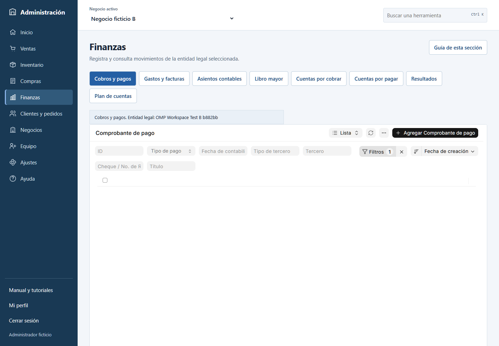

## Clientes y pedidos

Organiza clientes, pedidos y entregas con documentos relacionados.

1. **Gestiona clientes.** Clientes abre la lista nativa. Nuevo permite registrar nombre, tipo, grupo y contactos. Busca primero para evitar duplicados.
2. **Crea un pedido.** Pedidos de venta registra cliente, empresa, productos, cantidades y fecha de entrega. Guarda como borrador o envía cuando esté confirmado.
3. **Registra entregas.** Desde un pedido enviado, usa Crear para generar la entrega relacionada. Revisa el almacén y las cantidades pendientes. También puedes abrir Entregas desde este menú.
4. **Conserva la relación.** Usa los botones Crear de los documentos nativos para relacionar pedido, entrega y factura. No vuelvas a facturar una venta que ya se guardó en caja.

- La venta rápida de caja usa el cliente de mostrador del perfil. Los pedidos con seguimiento se gestionan aquí.

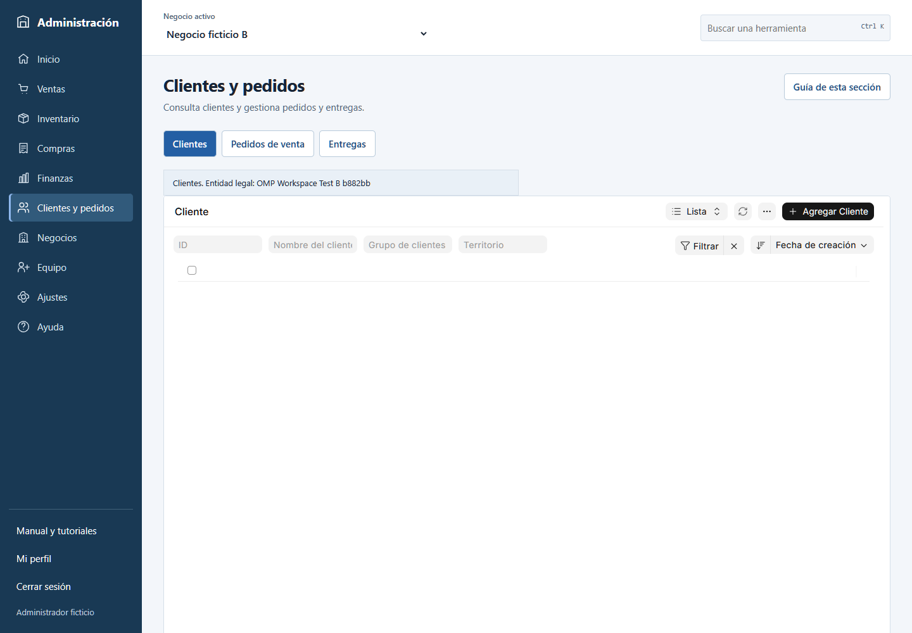

## Negocios

Edita la identificación de cada negocio y su relación con una entidad legal.

1. **Agrega un negocio.** Agregar negocio pide nombre comercial. Selecciona una entidad existente si comparte NIT y contabilidad, o crea otra con nombre, abreviatura y moneda. Se crean almacén, lista de precios, cliente de mostrador, medios de pago y perfil de caja nativos.
2. **Edita el perfil.** Nombre comercial identifica el selector y el recibo. Razón social, NIT, teléfono, correo y dirección son textos del perfil. El mensaje final y el enlace HTTPS del QR son opcionales.
3. **Guarda los datos.** Guardar perfil cambia los nuevos recibos. Los recibos guardados conservan la información y las opciones seleccionadas al vender.
4. **Configura la impresión.** En Ajustes, decide qué datos se imprimen para este negocio. El nombre comercial siempre identifica las líneas de su sección en una cesta mixta.
5. **Edita la entidad contable.** Editar entidad legal abre Empresa en ERPNext. Los datos contables se gestionan allí; cambiar el NIT escrito para el recibo no modifica automáticamente la empresa.

- No es necesario publicar nombres, NIT ni contactos en el repositorio para configurar el programa. Se guardan en la base de datos privada.

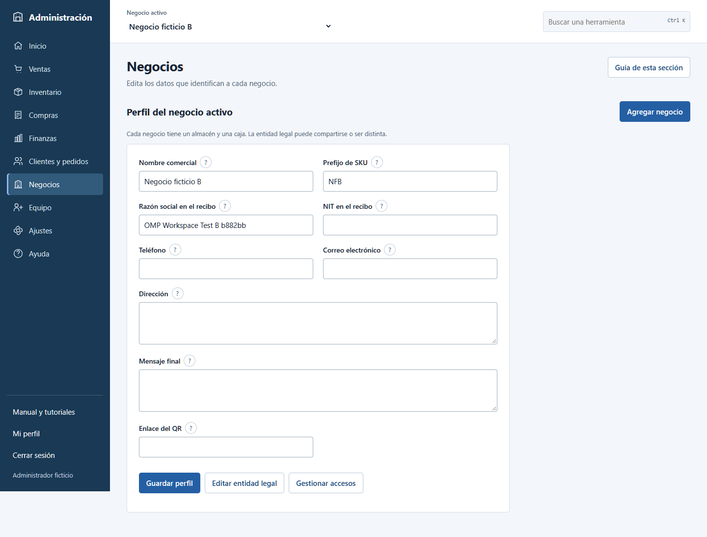

## Equipo

Crea cuentas personales y asigna el nivel de acceso.

1. **Crea una cuenta.** Crear perfil solicita nombre, correo de acceso y contraseña inicial de 12 a 128 caracteres. No envía correos ni guarda la contraseña en el navegador.
2. **Selecciona el permiso.** Administrador puede gestionar configuración y otras cuentas. Cajero opera solo las terminales y negocios asignados. La autorización se comprueba también en el servidor.
3. **Asigna negocios.** En el formulario, marca los negocios que podrá usar. Se asignan permisos nativos y una terminal personal por negocio. No compartas una misma cuenta entre personas.
4. **Mantén tu perfil.** Mi perfil abre tu cuenta nativa para actualizar datos y contraseña. Una cuenta administrativa permite mantener las cuentas desde Usuario y sus permisos nativos.

- El primer perfil humano se crea desde una sesión administrativa de instalación. No hay registro público de administradores.
- Los permisos administrativos son amplios en las entidades del sitio; usa Cajero cuando no sea necesario gestionar la configuración.

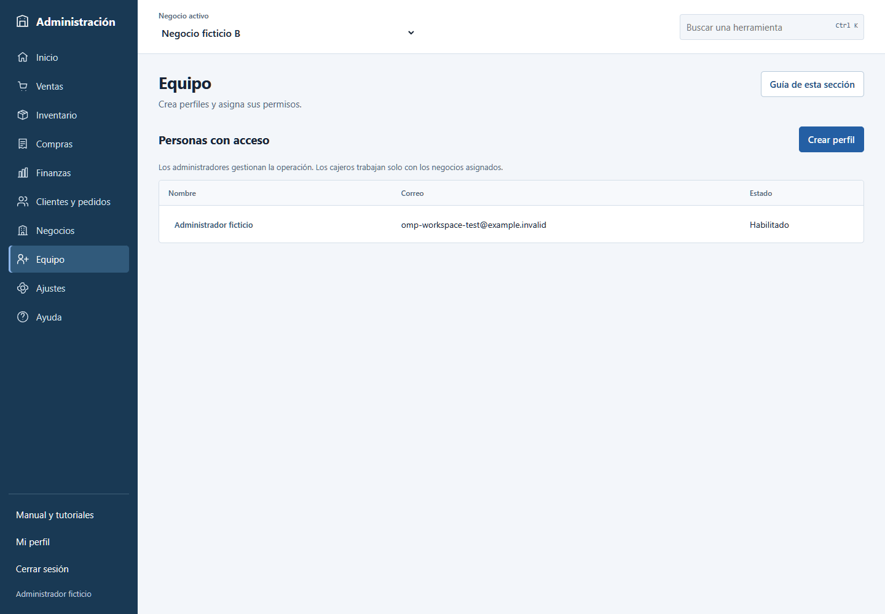

## Ajustes

Configura la presentación y los equipos de esta instalación.

1. **Elige idioma y formato.** Idioma del programa cambia la interfaz. Formato regional controla la presentación de números. Los valores iniciales son español y Colombia.
2. **Define moneda y hora.** Moneda de nuevos negocios se propone al crear una entidad; no convierte documentos existentes. Zona horaria controla nuevas fechas operativas. El valor inicial es America/Bogota.
3. **Configura el lector.** Lector con teclado US interpreta los códigos físicos solo en campos de escaneo. Terminador indica si el equipo termina con Enter o Tab. Conserva la opción que usa el lector instalado.
4. **Elige datos del recibo.** Activa razón social, NIT, teléfono, correo, dirección, mensaje final o QR de forma independiente para el negocio activo. Guarda las opciones y cambia de negocio para configurar el otro.
5. **Conserva el ajuste de impresión.** En el diálogo del navegador selecciona la cola instalada, Márgenes Mínimo y desactiva Encabezados y pies de página. Usa papel adaptable si el controlador lo ofrece. El documento ajusta su altura al contenido; el controlador puede conservar su longitud fija.

6. **Consulta el respaldo.** En Respaldo y recuperación revisa la última copia verificada y el último ensayo de restauración. Si falta una copia reciente, consulta el [procedimiento de recuperación](recovery.md). El computador y WSL deben estar encendidos para ejecutar el respaldo diario.

- La instalación se centra en la impresora Windows y el lector existentes. No requiere probar otros modelos.
- El navegador no permite al sitio imponer silenciosamente márgenes, cola, encabezados o tamaño del controlador. Esas opciones se conservan en el navegador/controlador.
- Oculta QR y datos de contacto que no necesites para reducir papel; las opciones son independientes por negocio.

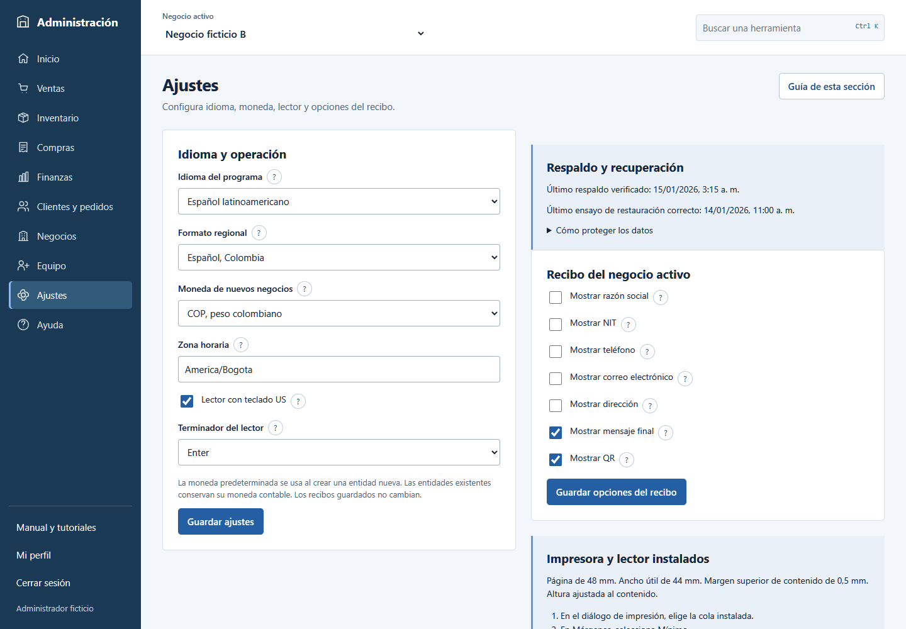

### Vista previa en Impresión de ERPNext

1. En **Configuración de impresión** de ERPNext, pulsa **Vista previa del recibo**. También puedes abrirla desde **Administración > Ajustes > Recibo del negocio activo**. Se requiere una cuenta administrativa.
2. Selecciona el negocio. **Muestra con las opciones guardadas** usa sus datos actuales con un producto y un importe de ejemplo. Guarda los cambios del perfil antes de abrirla.
3. Para revisar una venta, selecciona **Recibo de una venta guardada** y elige una factura o un recibo conjunto reciente. La lista consulta hasta 30 facturas del negocio y 30 cestas recientes del sitio. Para una factura anterior, escribe su número completo; ese campo tiene prioridad sobre la lista.
4. Pulsa **Ver recibo**. La venta guardada usa su instantánea original; cambiar contactos o visibilidad después no reescribe el historial. Un recibo conjunto exige permiso para todas sus facturas y negocios. Las facturas deben estar enviadas y conservar su contexto original; una factura anulada no se ofrece.
5. Si necesitas una copia, pulsa **Imprimir este recibo**. Se vuelve a comprobar el acceso antes de abrir el diálogo del navegador. Conserva el preset de la impresora instalada. Abrir la vista previa no crea ventas, mueve existencias ni marca documentos como impresos.

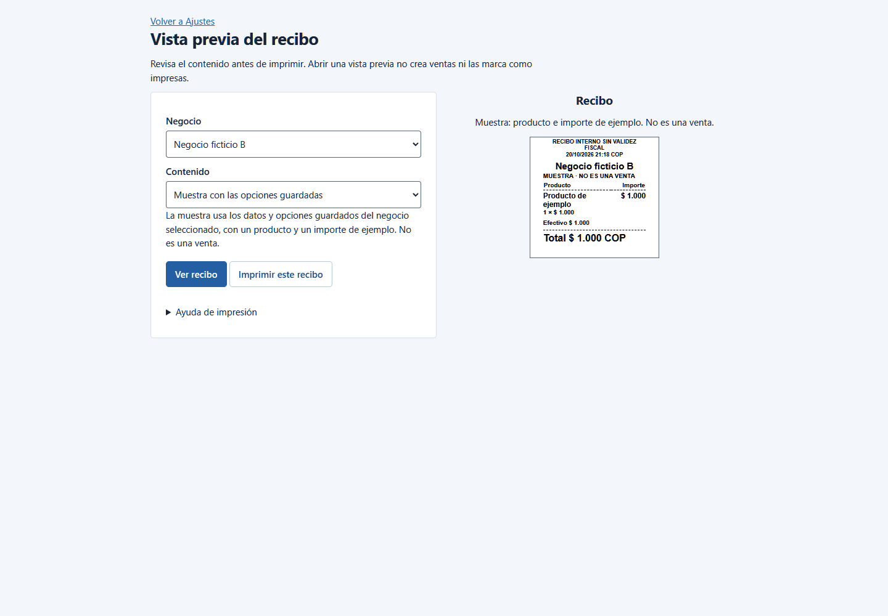

## Ayuda

Consulta el manual mientras trabajas o repite una guía.

1. **Busca por tarea.** Escribe una palabra como cierre, código de barras o proveedor. El manual filtra secciones y pasos relacionados.
2. **Lee los pasos y capturas.** Cada sección incluye instrucciones, límites y una captura generada con datos ficticios. Despliega Ver captura de esta sección para verla.
3. **Abre la guía.** Abrir tutorial lleva a la sección y resalta los controles. Usa Anterior, Siguiente o Terminar. Puedes omitirla y volver a abrirla cuando quieras.
4. **Consulta cada opción.** Los botones de ayuda con signo de interrogación explican campos y consecuencias. Se pueden abrir con teclado y cerrar con Escape. Los formularios nativos conservan su propia ayuda contextual.

- Las guías no bloquean la operación ni marcan tareas como realizadas. Guardar y Enviar siguen siendo acciones explícitas.

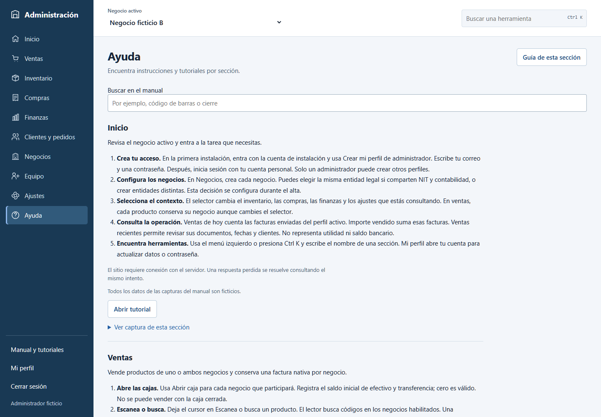

## Importar inventario

Abre **Importar inventario** en el menú o **Importar archivo** en Inventario. Cada archivo pertenece a un solo negocio y al almacén de su perfil POS. Revisa el selector antes de empezar.

1. Descarga la plantilla y conserva sus ocho encabezados. Guarda como CSV UTF-8, de hasta 100 filas y 256 KiB. Se admiten coma, punto y coma o tabulación como separador. En Excel, configura SKU y códigos de barras como texto para conservar ceros iniciales.
2. Selecciona el archivo y prepara la vista previa. Este paso no crea productos ni movimientos. Corrige las filas indicadas y vuelve a cargar el archivo si hay errores.
3. Revisa negocio, almacén, precios, códigos, cantidades anteriores y resultantes, y valor de entrada. Marca la confirmación y pulsa Aplicar. Si el catálogo o las existencias cambiaron, actualiza y revisa otra vez la vista previa.
4. Consulta los SKU resultantes y el movimiento nativo. Un SKU vacío en una fila nueva se genera con el prefijo configurado del negocio. Los SKU existentes se conservan.

| Columna | Uso |
| --- | --- |
| accion | `crear`, `actualizar` o `ingresar`. |
| sku | Obligatorio para actualizar o ingresar; opcional para crear. Debe ser único. |
| nombre | Obligatorio para crear; vacío conserva el nombre al actualizar. |
| codigo_barras | Opcional al crear o actualizar; agrega un código sin borrar los anteriores. No puede pertenecer a otro producto. |
| grupo | Grupo final permitido por el perfil; obligatorio al crear. |
| precio | Precio de venta positivo, sin símbolo ni separadores de miles; vacío conserva el precio al actualizar. |
| cantidad | Unidades enteras que se **suman** al almacén, no el saldo final. Cero o vacío no mueve stock. |
| costo | Costo unitario positivo obligatorio si hay cantidad; vacío cuando no hay entrada. |

Para `ingresar`, indica SKU, cantidad y costo; deja vacíos los campos de catálogo. Puede recibir stock de un producto que todavía no tenga precio de venta. Los decimales admiten punto o coma; si la coma también separa columnas, encierra ese campo entre comillas. No incluyas fórmulas de hoja de cálculo.

Una aplicación crea o actualiza productos y precios y, cuando hay cantidades, envía una sola Entrada de material nativa para el archivo. Todo se guarda en la misma transacción: un fallo revierte catálogo, stock y contabilidad. Si el mismo contenido ya fue aplicado, aparece una advertencia: confirma otra recepción únicamente si representa mercancía adicional. El sistema no puede determinar si dos archivos distintos corresponden a la misma entrega física.

Si se pierde la respuesta, vuelve a la sección con la misma cuenta y navegador: consulta el estado o reintenta el intento guardado. No vuelvas a cargar el archivo como otra entrada. Resolver sin aplicar bloquea solicitudes tardías o recupera el resultado ya guardado. El navegador guarda la referencia del intento; el archivo normalizado se conserva de forma privada en el servidor y en sus respaldos. No se publica en GitHub.

Este flujo admite productos simples de stock con unidad Nos. Series, lotes, variantes, paquetes, cantidades fraccionarias y precios especiales se gestionan con los formularios nativos. No combines esta entrada con otra recepción o factura que ya haya ingresado la misma mercancía.

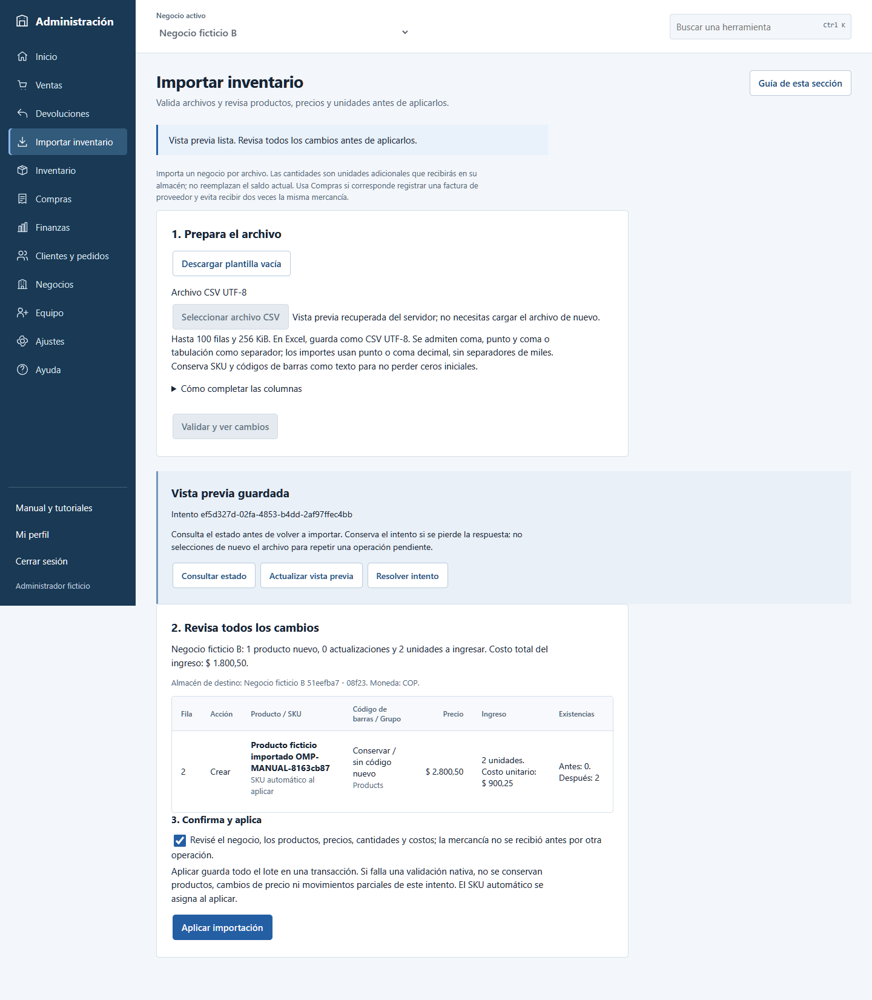

## Si algo no responde

Después de encender Windows, usa `scripts/start-openmultipos.cmd` para iniciar el programa. El [manual de respaldo y recuperación](recovery.md) explica cómo crear/verificar copias, ensayar su restauración y actuar si falla el disco o el sitio.

- **Venta pendiente:** conserva la sesión y el almacenamiento. Consultar estado recupera el resultado; Reintentar conserva la misma clave. Resolver sin crear venta recupera lo guardado o bloquea el intento. No vuelvas a cobrar por una respuesta perdida.
- **Entrada pendiente:** revisa la misma entrada o resuélvela antes de crear otra. No combines recepción directa y compra con stock para la misma mercancía.
- **Recibo no disponible:** vuelve a cargar el recibo guardado; no crees otra venta para imprimirlo.
- **Impresión con espacio sobrante:** conserva Márgenes Mínimo, encabezados/pies desactivados y el papel adaptable del controlador si está disponible. El controlador puede imponer una longitud fija.
- **Producto sin coincidencia:** revisa su código, propietario, precio vigente, almacén, existencias y que su perfil esté habilitado.
- **Acceso denegado:** usa tu cuenta personal y pide al administrador revisar los negocios y terminales asignados. El selector no concede permisos.

## Herramientas nativas por tarea

| Necesito | Sección y herramienta | Qué revisar |
| --- | --- | --- |
| Registrar una factura de proveedor | Compras > Facturas de compra | Proveedor, empresa, productos, impuestos y recepción relacionada. |
| Pedir mercancía | Compras > Órdenes de compra | Cantidades, fecha y proveedor; crear recepción desde el pedido. |
| Registrar mercancía recibida | Compras > Recepción de mercancía | Almacén, cantidades y pedido; conservar la relación con la factura. |
| Registrar un gasto | Finanzas > Gastos y facturas | Cuenta de gasto, tercero, impuestos y que no esté ya registrado. |
| Pagar o cobrar una obligación | Finanzas > Cobros y pagos | Tipo, tercero, cuenta, importe y facturas conciliadas. |
| Revisar movimientos de cuenta | Finanzas > Libro mayor | Empresa, cuenta, fechas y documentos enviados. |
| Revisar obligaciones pendientes | Finanzas > Cuentas por cobrar / pagar | Tercero, fechas, vencimiento y moneda. |
| Revisar ingresos y gastos | Finanzas > Resultados | Empresa, ejercicio y periodo. No equivale al saldo de caja. |
| Registrar un ajuste contable | Finanzas > Asientos contables | Débitos/créditos, cuentas y documentos relacionados. |
| Mantener cuentas | Finanzas > Plan de cuentas | Empresa, grupo, tipo y moneda de cuenta. |
| Mantener datos de clientes | Clientes y pedidos > Clientes | Nombre, grupo y contactos; buscar antes de duplicar. |
| Seguir un encargo | Clientes y pedidos > Pedidos de venta | Cliente, fecha, productos y estado; crear documentos relacionados. |
| Entregar un pedido | Clientes y pedidos > Entregas | Pedido, almacén y cantidades pendientes. |
| Actualizar una cuenta personal | Mi perfil | Datos de acceso y contraseña. |

Los clientes y proveedores se comparten en el sitio; sus facturas, pedidos y movimientos conservan su empresa. Revisa Empresa al crear esos documentos.

Una cuenta administrativa conserva acceso amplio a los documentos del sitio. Revisa Empresa dentro de cada formulario; el filtro del menú se puede cambiar y no representa una restricción de seguridad.

## Garantías

1. Selecciona el negocio y abre Garantías. Escribe el número de la venta original y usa Consultar venta.
2. Selecciona el artículo, la fecha de recepción y el motivo. Registrar reclamación crea el documento nativo sin cobrar ni mover inventario.
3. Si se pierde la respuesta, consulta o reintenta el mismo intento. Abandonar confirma el resultado o bloquea una solicitud tardía antes de permitir otra reclamación.
4. Abre una reclamación reciente o búscala por número. Actualizar seguimiento permite revisar estado y notas; si alguien la cambió, vuelve a consultarla antes de guardar.
5. Cerrar registra la fecha nativa de resolución. El seguimiento no confirma cobertura ni calcula periodos/plazos automáticos.

[Recuperación, permisos y límites](warranties.md). Las reparaciones pagadas, devoluciones y cambios de existencias mantienen flujos separados.

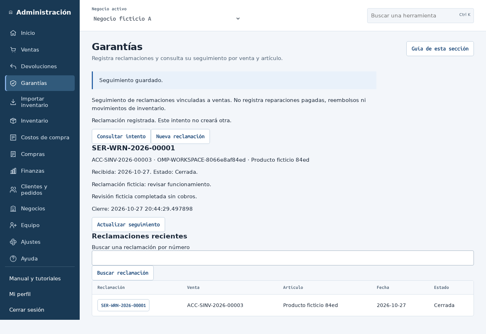
